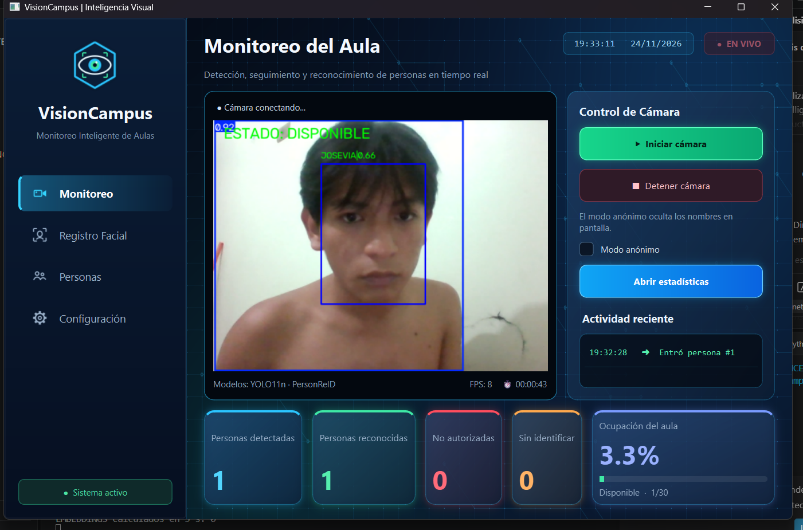
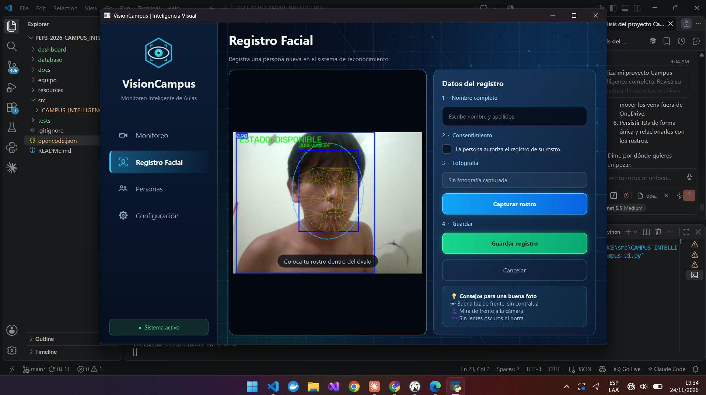
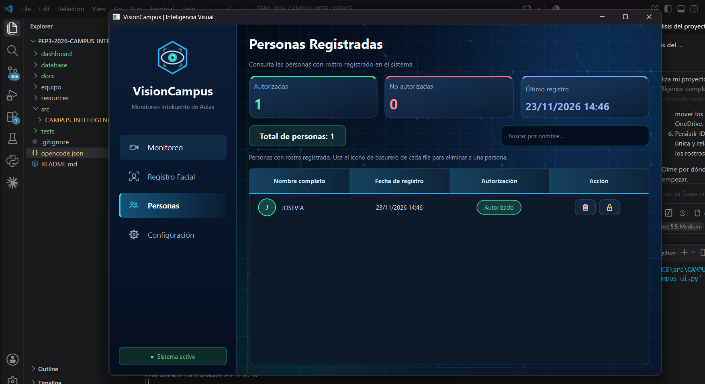
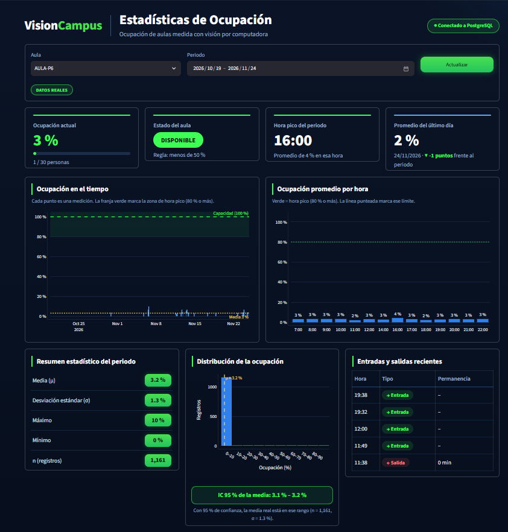
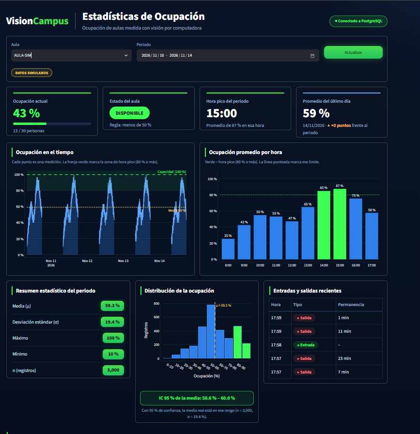

# Pruebas y evidencias de funcionamiento

Este documento muestra, con capturas de pantalla, que VisionCampus funciona.
Las capturas corresponden a la aplicación de escritorio ejecutándose con la cámara real.

## 1. Monitoreo del aula

Se ve:
- La cámara en vivo con la detección de la persona (recuadro del cuerpo) y el reconocimiento facial (nombre y similitud).
- Las tarjetas de estadísticas: personas detectadas, reconocidas, no autorizadas y sin identificar.
- La ocupación del aula (1 de 30 personas, 3.3 %, estado "Disponible").
- La actividad reciente: la entrada de la persona registrada con su hora.
- El rendimiento: FPS y tiempo de ejecución.

## 2. Registro facial

Se ve:
- El formulario de registro en cuatro pasos: nombre, consentimiento, fotografía y guardar.
- La guía en forma de óvalo para colocar el rostro.
- La malla de puntos del rostro detectado.
- Los consejos para una buena fotografía.

El registro solo se guarda si la persona escribe su nombre, marca el consentimiento y captura su rostro.

## 3. Personas registradas

Se ve:
- Los rostros guardados en la base de datos PostgreSQL, con su nombre y fecha de registro.
- El estado de autorización de cada persona y el botón del candado para cambiarlo.
- El botón de la papelera para eliminar a una persona.
- El resumen: autorizadas, no autorizadas y último registro.

## 4. Base de datos

El esquema completo de la base está en [`database/scripts/01_schema.sql`](../../database/scripts/01_schema.sql). Se puede ejecutar en una base vacía y crea las cuatro tablas del sistema:
`aulas`, `eventos`, `ocupacion_historico` y `rostros_registrados`.

## 5. Dashboard de estadísticas

El tablero de Streamlit está en la carpeta [`dashboard/`](../../dashboard/). Lee las tablas de la base de datos PostgreSQL (con el mismo método de conexión de la aplicación) y calcula la media, la desviación estándar, el intervalo de confianza del 95 %, las probabilidades observadas y los percentiles.
Los datos reales y los simulados se muestran separados y rotulados.

### 5.1 Datos reales (aula AULA-P6)

Se ve:
- La etiqueta "Conectado a PostgreSQL" y la etiqueta "DATOS REALES".
- 1,161 registros de ocupación medidos por la cámara, del 19/10/2026 al 24/11/2026.
- Ocupación media de 3.2 % (una persona en un aula de 30), con desviación estándar de 1.3 % e intervalo de confianza del 95 %.
- Las últimas entradas y salidas registradas por la aplicación.

### 5.2 Datos simulados (aula AULA-SIM)

Se ve:
- La etiqueta "DATOS SIMULADOS": son datos ficticios generados con `dashboard/generar_datos_simulados.py` (3,000 registros de ocupación y 4,190 eventos en 5 días) para mostrar cómo se ve el tablero con una ocupación más variada.
- Picos de ocupación entre las 14:00 y las 16:00, y la distribución de la ocupación con su media (59.3 %).

Los datos simulados nunca se mezclan con los reales: cada aula se consulta por separado.

## 6. Limitaciones conocidas

- Los datos de AULA-SIM son simulados y no describen una universidad real. Los datos reales de AULA-P6 vienen de pruebas con una sola persona, por eso la ocupación es baja.
- Al cerrar el programa, las personas que siguen dentro quedan con una ENTRADA sin su SALIDA.
- Los identificadores de persona reinician en 1 cada vez que se enciende la cámara.
- El reconocimiento facial se probó con pocos voluntarios y su umbral aún se está calibrando.
